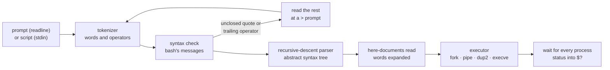
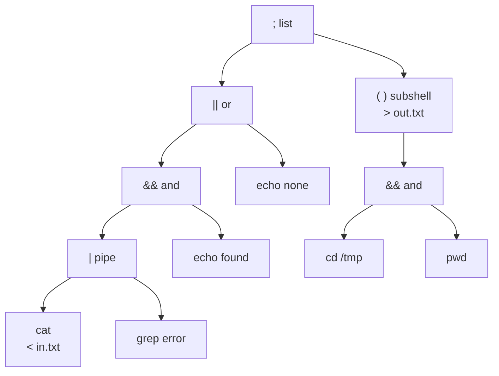

<div align="center">

# minishell · 42 Paris

**A bash-compatible shell in C: a tokenizer, a recursive-descent parser and a tree-walking executor that run pipelines, subshells, `&&`, `||` and `;`, here-documents and wildcards, with bash's error messages, exit statuses and signal behaviour.**


</div>

---

## Results

| | |
|---|---|
| **Final grade** | **125 / 100**, the maximum possible (mandatory part + every bonus) |
| **Peer evaluations** | 3 / 3 passed at 125% |
| **Bonus** | `&&` and `\|\|` with parentheses for priorities, and the `*` wildcard |
| **Beyond the subject** | `;` lists, `\` escapes, subshells that can be piped and redirected, multi-line input, a script mode with bash's line numbers, here-document expansion, bash's error messages ([full list](#mandatory-part-bonus-and-beyond)) |
| **Testing** | `make test` runs 973 automated cases through bash 5.2 and through minishell, comparing output, errors and exit status: 913 identical. `make leaks` checks every process with Valgrind ([details](#testing)) |
| **Size** | About 5,700 lines of C in 75 files, plus libft |
| **Format** | About five weeks, 5 February to 8 March 2026 |
| **School** | 42 Paris, Common Core curriculum (completed) |

The bonus is only graded when the mandatory part is perfect, so 125 means nothing failed anywhere.

What my evaluators wrote (the last two translated from French):

> *"Passed all the tests. […] Good job!"*

> *"Excellent project: despite my attempts to break it, everything works. […]"*

> *"[…] All the bonuses are implemented on top of the mandatory part. Thank you for taking the time to explain to me how your tree and your testing process work. […]"*

One evaluator spent the defense trying to break the shell with edge cases. With another, the defense turned into a detailed walkthrough of the abstract syntax tree and of the differential testing process, both described below.

---

## Context: the 42 Common Core

42 is a software engineering school with no teachers, lectures or classes. Students learn by building projects, and every project is graded by other students through live code reviews and defenses.

The **Common Core** is 42's main curriculum. Students start it after passing the Piscine, a month-long selection bootcamp, and it typically takes 18 to 24 months. It is a series of projects grouped into ranks, and each rank must be completed before the next one opens. The projects start with C and Unix fundamentals, then cover algorithms, concurrency, system administration, networking, graphics and C++, and finish with a full-stack web application built as a team.

minishell comes in the same rank as [Philosophers](https://github.com/R-FLM/42_philosophers), after [pipex](https://github.com/R-FLM/42_pipex), whose `fork`, `pipe`, `dup2`, `execve` and `waitpid` it builds on. It is the first large program of the curriculum: a lexer, a parser, an interpreter and a process manager that must agree with bash on every edge case, under 42's coding standard.

**I have completed the entire Common Core.**

---

## Description

minishell reads a command line, typed at a prompt with line editing and history, or read from a script, and runs it the way bash would:

```console
minishell> echo "Hello $USER" '$USER' | tr a-z A-Z
HELLO FLOMULLE $USER
minishell> (cd /tmp && pwd) && ls
/tmp
lexer.c  main.c  Makefile  notes.txt  parser.c
minishell> cat << EOF | wc -l
> first line
> second line, $USER
> EOF
2
```

Each line goes through the same stages as in a real shell: it is cut into tokens, checked against the grammar, parsed into a tree, expanded, and then the tree is executed.



### Mandatory part, bonus and beyond

The subject asks for a shell that handles the essentials and, for the bonus, logical operators and wildcards. Everything in italics below goes further than the subject, sometimes against its advice: it says not to interpret `\` or `;`, and minishell interprets both, as bash does.

| Requirement | Implementation |
|---|---|
| **Prompt and history** | `minishell> ` prompt with GNU Readline line editing and history. Ctrl-D on an empty line prints `exit` and quits |
| **Find and run executables** | A name containing `/` runs as given, any other is searched in each `PATH` directory in order. 127 when not found, 126 for a directory or a file without execute permission, with bash's messages |
| **Quotes `'` and `"`** | Single quotes keep everything literal, double quotes still expand `$`. Quoted parts can be glued together: `"e"'c'ho` runs `echo` |
| **Redirections `<` `>` `>>` `<<`** | Any number, anywhere around the arguments (`> out cmd arg < in` works), applied left to right like bash |
| **Pipes** | Any length, every command running at the same time: three `sleep 1` take 1.0 s. No command inherits a descriptor it should not see |
| **`$VAR` and `$?`** | Expanded outside single quotes, then split into words and stripped of quotes, in bash's order |
| **Ctrl-C, Ctrl-D and Ctrl-\\** | Same behaviour as bash at the prompt, while a command runs and in a here-document, statuses 130 and 131 included ([table](#signals)) |
| **Builtins** | `echo -n`, `cd`, `pwd`, `export`, `unset`, `env` and `exit` |
| **At most one global variable** | `g_signal`, a `volatile sig_atomic_t` that only holds the number of the signal received |
| **No memory leak** (readline's own excepted) | Valgrind, following every child process: 0 bytes lost, no descriptor left open ([testing](#testing)) |
| **Bonus: `&&`, `\|\|` and parentheses** | Short-circuit evaluation, nested to any depth: `(a \|\| b) && (c \|\| d)` |
| **Bonus: `*` wildcard** | Matches the files of the current directory, skips hidden files and sorts the result |
| *`;` command lists* | `cmd1 ; cmd2 ; cmd3`, with bash's syntax errors for `;;` or a leading `;` |
| *Backslash escapes* | Outside quotes, `\` makes the next character literal: `echo a\ b \$HOME` prints `a b $HOME` |
| *Multi-line input* | An unclosed quote, or a line ending with `\`, `\|`, `&&` or `\|\|`, opens a `> ` prompt for the rest, as in bash. The subject only asks not to interpret unclosed quotes |
| *Real subshells* | `( … )` runs in a child process, so a `cd` or `export` inside does not leak out. A subshell can be piped, redirected (`( … ) > out`) and nested |
| *Here-document expansion* | `$VAR` and `$?` are expanded in the body unless the delimiter is quoted (`<< 'EOF'`). Every document is read before anything runs, as in bash. Ctrl-C cancels the whole line, and end of input ends the document with a warning, as in bash |
| *Wildcards in redirections* | `cat < *.log` reads the only match. Several matches give bash's `ambiguous redirect` |
| *Script mode* | Without a terminal, commands are read from standard input, so `./minishell < script.sh` runs a script. Errors carry bash's `line N:` prefix, syntax errors repeat the faulty line, and the shell exits with the last status |
| *bash's error messages* | `minishell: context: reason` on standard error, in bash's wording. A newline in a command name is shown as `$'a\nb'`, as bash does |
| *Fatal signals reported* | `Quit (core dumped)` and `Segmentation fault (core dumped)`, and status 128 + n for a command killed by signal n |
| *Fuller builtins* | `cd` alone, `cd ~` and `cd ~/dir`, updating `PWD` and `OLDPWD`. `export` alone lists the variables sorted, `export NAME` declares one without a value, `export NAME+=value` appends. `exit` validates its argument, wraps it modulo 256, and stays in the shell on `too many arguments`. `echo -nnn -n` works like bash |
| *Named after `argv[0]`* | Started through a link called `myshell`, the prompt becomes `myshell> ` and errors start with `myshell:` |
| *Empty environment* | `env -i ./minishell` starts, and runs commands given with their path |

---

## Skills demonstrated

| Area | What I learned | Why it matters in production |
|---|---|---|
| **Lexical analysis** | Cutting a line into words and operators by longest match (`\|\|` before `\|`, `>>` before `>`), while quotes and escaped spaces stay inside one word | Every compiler, interpreter, query engine and configuration parser starts with a lexer |
| **Grammars and parsing** | Writing a grammar with operator precedence and turning it into a recursive-descent parser, one function per rule, that builds an abstract syntax tree | The standard way to implement a domain-specific language, a query language or a templating engine, and to give precise syntax errors |
| **Interpreting a tree** | Walking the tree to run it: short-circuit logic, exit statuses flowing back up, subshells as forked copies of the interpreter | The model behind interpreters, rule engines, build systems and CI pipelines described as trees of steps |
| **Process management** | `fork`, `execve` and `waitpid` for every command, every process of a pipeline started before waiting for any, builtins kept in the shell process when they must change its state | What shells, process supervisors, CI runners and container entry points do all day |
| **File descriptors** | Wiring pipes and redirections with `dup2`, saving and restoring the shell's own standard input and output, closing every descriptor a command should not see | A forgotten descriptor hangs a pipeline, and leaked descriptors eventually exhaust a long-running server |
| **Signals and the terminal** | `sigaction` handlers that differ at the prompt, in a here-document and in children; one `sig_atomic_t` global; saving and restoring terminal settings with `termios` | Clean Ctrl-C handling in command-line tools, graceful shutdown of services, terminal state that survives a crash |
| **Context-aware text processing** | Expanding variables, splitting words, matching wildcards and removing quotes, each step aware of which characters are quoted or escaped | The same discipline that prevents injection bugs when building commands, queries or templates from user input |
| **Compatibility engineering** | Matching a reference implementation on every observable result: output, error wording, exit status, and edge cases such as `exit -9223372036854775808` | Drop-in replacements, migrations and API compatibility are judged on exactly this |
| **Differential testing** | Running 973 command lines through bash and through minishell and comparing standard output, standard error and exit status | Testing a rewrite against the program it replaces, with the original as the oracle |
| **Resource discipline** | One error path that reports, cleans and exits; freeing everything after each line; checking with Valgrind in every child process | Long-running programs cannot afford leaks, and failure paths are where they hide |
| **Code organisation** | 75 files in directories that follow the stages of a command line, with functions documented in their headers, all passing `norminette` | A codebase other people can find their way around, under a team's style rules |

---

## Technical overview

### Constraints

| Rule | Requirement |
|---|---|
| **Allowed functions** | `readline`, `rl_clear_history`, `rl_on_new_line`, `rl_replace_line`, `rl_redisplay`, `add_history`, `printf`, `malloc`, `free`, `write`, `access`, `open`, `read`, `close`, `fork`, `wait`, `waitpid`, `wait3`, `wait4`, `signal`, `sigaction`, `sigemptyset`, `sigaddset`, `kill`, `exit`, `getcwd`, `chdir`, `stat`, `lstat`, `fstat`, `unlink`, `execve`, `dup`, `dup2`, `pipe`, `opendir`, `readdir`, `closedir`, `strerror`, `perror`, `isatty`, `ttyname`, `ttyslot`, `ioctl`, `getenv`, `tcsetattr`, `tcgetattr`, the termcap functions, and libft |
| **Reference** | bash: when a requirement is unclear, do what bash does |
| **Global variables** | At most one, holding nothing but the number of a received signal |
| **Scope** | Do not interpret unclosed quotes, or characters the subject does not ask for, such as `\` and `;` |
| **Compilation** | `cc -Wall -Wextra -Werror`, with a Makefile that must not relink |
| **The Norm** | 42's coding standard: at most 25 lines per function, 5 functions per file, 4 parameters, 5 local variables and 80 columns. No `for`, `switch`, `do…while` or ternary operator |
| **Grading** | A crash, a memory leak or one Norm error gives the whole project 0. The bonus is only assessed if the mandatory part is perfect |

### Grammar

The parser implements this grammar, one function per rule in [parsing.c](src/2_parsing_ast/parsing.c):

```
list      →  pipeline  ( ( "&&" | "||" | ";" )  pipeline )*        parse_logical_operators
pipeline  →  command  ( "|"  command )*                            parse_pipelines
command   →  "("  list  ")"  redirect*                             parse_subshell
          |  ( WORD | redirect )+                                  parse_command
redirect  →  ( "<" | ">" | ">>" | "<<" )  WORD                     parse_redir
```

Since pipelines are parsed one level below the logical operators, `|` binds tighter: `a && b | c` means `a && (b | c)`. The three list operators share one level and group from the left. bash gives `;` a lower priority, but the result is the same, because commands still run from left to right and `&&` and `||` only look at the status of what ran just before.

### A command line, step by step

For this line:

```bash
cat < in.txt | grep error && echo found || echo none ; (cd /tmp && pwd) > out.txt
```

| Step | Stage | What happens |
|---|---|---|
| 1 | [Tokenizer](src/1_tokenization/1_1_tokens/tokens.c) | 21 tokens and an end-of-line marker: `cat` `<` `in.txt` `\|` `grep` `error` `&&` … `)` `>` `out.txt`. Operators are found by longest match, and a quoted or escaped part never ends a word |
| 2 | [Syntax check](src/1_tokenization/1_2_syntax/syntax_p1.c) | Each token is checked against its neighbours: a redirection needs a word, an operator needs a command on its left, parentheses must balance. At the prompt, a missing right-hand side at the end of a line, as in `ls \|`, asks for one more line instead of failing |
| 3 | [Parser](src/2_parsing_ast/parsing.c) | Builds the tree below. Redirections stay attached to the command or subshell they belong to |
| 4 | [Here-documents and expansion](src/2_parsing_ast/expand_and_heredoc.c) | One walk over the tree reads every here-document, then expands every word: variables, word splitting, wildcards, backslashes and quotes |
| 5 | [Executor](src/3_execution/3_3_ast_execution/exec.c) | Walks the tree from the root: the pipeline runs, `&&` and `\|\|` look at its status, then `;` runs the subshell |
| 6 | [Wait](src/3_execution/3_3_ast_execution/exec_wait.c) | Every process left is waited for, and the last status goes into `$?` |



### Running the tree

Each node type has one rule:

| Node | Execution |
|---|---|
| **`;`** | Run the left side and wait for it, then run the right side |
| **`&&` / `\|\|`** | Run the left side and wait for it. Run the right side only if the status is 0, or only if it is not |
| **`\|`** | Create a pipe, give its write end to the last command of the left side and its read end to the first command of the right side, then start both sides **without waiting** in between |
| **command** | Builtins that change the shell (`cd`, `export NAME=value`, `unset`, `exit`) run in the shell process, unless they are part of a pipeline, like in bash. Any other command forks: the child restores default signal handlers, plugs in its pipe ends, applies its redirections from left to right, then runs the builtin or calls `execve` |
| **subshell** | Fork. The child plugs in its pipe ends, applies its redirections, runs its subtree with the same executor, and exits with its status |

The two functions at the heart of it, from [exec.c](src/3_execution/3_3_ast_execution/exec.c), without their null checks:

```c
static void	exec_pipe(t_shell *sh, t_ast *node)
{
	if (!setup_pipe(sh, node))    // pipe(), then attach both ends to the right leaves
		return ;
	exec(sh, node->left);         // forks and returns at once
	exec(sh, node->right);        // so both sides run at the same time
}

static void	exec_logop(t_shell *sh, t_ast *node)
{
	exec(sh, node->left);
	sh->status = wait_ast(node->left);    // the left side must finish first
	if (node->astkw == AST_AND)
	{
		if (sh->status == SUCCESS)
			return (exec(sh, node->right));
		return ;
	}
	else if (node->astkw == AST_OR)
	{
		if (sh->status != SUCCESS)
			return (exec(sh, node->right));
		return ;
	}
	else if (node->astkw == AST_THEN)
		return (exec(sh, node->right));
}
```

Starting every command of a pipeline before waiting is what keeps it from deadlocking: a command that writes more than a pipe holds (64 KiB on Linux) blocks until the next one reads. The parent closes its copy of each pipe end right after the fork that uses it, so every reader sees end of file when its writer exits. `ls /proc/self/fd` shows only 0, 1 and 2, plus the descriptor `ls` itself opens, at the start, in the middle and at the end of a pipeline.

### Exit statuses

| Situation | Status | Message on standard error |
|---|---|---|
| Command not found, or empty (`""`) | 127 | `minishell: nocmd: command not found` |
| Path to a file that does not exist | 127 | `minishell: ./nope: No such file or directory` |
| File without execute permission | 126 | `minishell: ./a.txt: Permission denied` |
| Directory given as a command | 126 | `minishell: /tmp: Is a directory` |
| Syntax error | 2 | ``minishell: syntax error near unexpected token `\|'`` |
| Unclosed quote at the end of a script | 2 | ``minishell: unexpected EOF while looking for matching `"'`` |
| Redirection that fails | 1 | `minishell: missing.txt: No such file or directory`, and the command does not run |
| Wildcard redirection with several matches | 1 | `minishell: *: ambiguous redirect` |
| Builtin misuse | 1 | `minishell: cd: too many arguments`, ``minishell: export: `9x=1': not a valid identifier`` |
| `exit` with a non-numeric argument | 2 | `minishell: exit: abc: numeric argument required` |
| Ctrl-C at the prompt or during a command | 130 | |
| Ctrl-\\ during a command | 131 | `Quit (core dumped)` |
| Command that crashes | 139 | `Segmentation fault (core dumped)` |
| Command killed by signal n | 128 + n | 137 for `SIGKILL`, 143 for `SIGTERM` |

In script mode, every message gets bash's `line N: ` prefix after the shell's name.

### Signals

| Where | Ctrl-C (`SIGINT`) | Ctrl-\\ (`SIGQUIT`) | Ctrl-D (end of input) |
|---|---|---|---|
| **At the prompt** | Discards the line and shows a new prompt. `$?` becomes 130 | Nothing happens | Prints `exit` and quits with the last status |
| **While a command runs** | The command stops, `$?` is 130 | The command stops with `Quit (core dumped)`, `$?` is 131 | Reaches the command as end of input |
| **In a here-document** | Cancels the whole line, nothing runs, `$?` is 130 | Nothing happens | Ends the document with a warning, as in bash |

The handlers do as little as possible: they store the signal number in `g_signal` and ask readline to redraw the prompt. While children run, the shell ignores both signals, so that only the children stop, and each child gets the default handlers back before `execve`. The terminal settings saved at startup are restored before every command, so a program that changes them, or crashes, does not leave the prompt broken.

### Implementation details

| Module | Detail |
|---|---|
| [minishell.c](src/minishell.c) | The main loop. With a terminal, reads lines with `readline` and keeps the history. Without one, reads standard input with get_next_line and counts lines for error messages. Each line is processed, executed and freed before the next |
| [0_initialization](src/0_initialization/init_shell.c) | Copies the environment (an empty one works), keeps copies of the standard input and output, derives the prompt and the error prefix from `argv[0]`, detects whether it runs in a terminal and saves its settings |
| [1_1_tokens](src/1_tokenization/1_1_tokens/) | The tokenizer: longest match for the 11 operators, words that keep their quotes and backslashes for the expansion stage, and an end-of-line token so the parser always knows where to stop |
| [1_2_syntax](src/1_tokenization/1_2_syntax/) | One rule per operator, checked against its neighbours, with bash's `syntax error near unexpected token` message. An odd number of backslashes at the end of a line, an unclosed quote, or a trailing `\|`, `&&` or `\|\|` read one more line and check again |
| [2_parsing_ast](src/2_parsing_ast/) | The recursive-descent parser and the here-documents. Each document is written to a file in `/tmp` named after a memory address unique to its redirection, so two documents of one line never share a file. The file is opened a second time for reading, then deleted at once: nothing stays on disk, even if the shell is killed |
| [3_1_expansion](src/3_execution/3_1_expansion/) | `$NAME`, `$?` and `$"…"` outside single quotes, word splitting that respects quotes, wildcards matched by a recursive function and sorted, then backslash and quote removal. Several wildcard matches in a redirection give `ambiguous redirect`. A quoted here-document delimiter turns expansion off for that document |
| [3_2_cmd_parsing](src/3_execution/3_2_cmd_parsing/) | Recognises builtins, runs names containing `/` as given, searches the others in `PATH` with `access`, and chooses 126 or 127 like bash |
| [3_3_ast_execution](src/3_execution/3_3_ast_execution/) | The executor described above: logical operators, pipes attached to the nearest commands, subshells, redirections applied in order, and the walk that waits for every process and turns a signal into 128 + n |
| [4_builtin_functions](src/4_builtin_functions/) | The seven builtins. `cd` still works after the current directory has been deleted, using `PWD` instead. `export` validates names, appends with `+=`, and lists variables in bash's POSIX format |
| [5_signal_handling](src/5_signal_handling/) | Four configurations: prompt, here-document, child, and ignore while children run. Terminal settings are saved, adjusted and restored with `tcgetattr` and `tcsetattr` |
| [6_cleaning](src/6_cleaning/) | `clean_prompt` frees one line's tokens, tree, redirections and descriptors. `clean_shell` frees everything, before the shell exits and in every child before `execve` |
| [7_error_handling](src/7_error_handling/) | One `error` function for every failure: it formats the message, adds the line number in script mode, quotes newlines as bash does, sets the status, and either returns or cleans up and exits, depending on the sign of the code it is given |

### Design trade-offs and scope

- **Words are expanded once per line, before anything runs.** After parsing, a single walk over the tree reads every here-document and expands every word, then the executor starts. Reading every here-document first is what bash does, but bash expands each command only when it is about to run it. So within one line, a command does not see what an earlier one changed: `export A=1 ; echo $A` prints an empty line, `false ; echo $?` prints the status of the previous line, and `cd src && ls *` matches the old directory. From one line to the next, at the prompt or in a script, everything is up to date. This accounts for 44 of the 60 differences in the [test suite](#testing). Calling the expansion from the executor, just before each command runs, and keeping only the here-documents in the first walk would remove them.
- **Backslash escapes stop at quotes.** The subject asks for no backslash handling at all. minishell supports it outside quotes, where `echo a\ b \$HOME` behaves as in bash, but not inside them: the quote checker closes a quoted section at the first escaped character, so `printf 'a\nb'` and `echo "a\"b"` are reported as unclosed quotes.
- **Here-documents need a terminal.** In script mode, the main loop and the here-document reader use two get_next_line buffers on two descriptors, and the first one has already read ahead, so the body of a `<<` cannot come from the script itself.
- **Wildcards cover `*` in the current directory**, the subject's scope: no `?`, `[…]` or `dir/*`, and hidden files are never matched, so `.*` stays as typed. Matches are sorted without regard to case, which gives bash's order in an English locale for most names, but not for names that differ only by case or punctuation. The matcher is a short recursive function that tries every split at every `*`, so on names that almost match, its cost grows exponentially with the number of stars: against a 40-character name, `a*a*…*b` takes 4 ms with 4 stars, 0.8 s with 8 and 9.8 s with 10. The [version below](#how-this-can-be-reused) needs at most pattern length × name length steps, and answers in 1 ms.
- **Every pipe of a pipeline is created before its first command starts.** With the usual limit of 1,024 open descriptors, a pipeline can have 510 commands, and the 511th pipe fails with `pipe: Too many open files`. Creating each pipe just before the fork that needs it would keep the number of descriptors constant.
- **Out of scope, as the subject allows:** background jobs and job control (`&` is a syntax error), descriptor numbers in redirections (`2>`, `2>&1`), `~` outside `cd`, `cd -`, `$$`, `SHLVL`, `env` with arguments, and `.` or `source`, which is reported as not implemented instead of being run as a directory.

### Testing

I tested minishell against the program it imitates. [test/flm_test.sh](test/flm_test.sh) reads a file of command lines and runs each one twice, through `bash --posix` and through minishell, both reading it from standard input. It compares standard output, standard error once each shell's name is removed from the start of the messages, and the exit status, and prints every difference. [test/flm_test_err.sh](test/flm_test_err.sh) does the same but prints only the cases that differ.

Four Makefile rules run every automated check:

| Rule | What it does | Result |
|---|---|---|
| `make test` | Runs the three case files below through bash and through minishell, each in a temporary copy of `test/` so that nothing is left in the repository, then lists the commands that differ and a summary. `make test VERBOSE=1` shows each difference in full | 913 / 973 identical, in about 20 seconds |
| `make leaks` | Runs a [session of 24 command lines](test/valgrind_cmds) under Valgrind, following every child process, and fails if minishell or one of its forks loses a byte, makes a memory error or leaves a descriptor open | 25 processes checked, all clean, in about 6 seconds |
| `make norm` | Runs norminette on `src` and `libft`, and fails on any error | 111 files OK |
| `make check` | All three | |

`make leaks` and `make norm` fail at the first problem. `make test` reports the differences instead of failing, since the remaining ones are known and explained below.

```console
$ make check
norminette: 111 files OK
Valgrind: 25 minishell processes checked, 0 bytes lost, 0 errors, no descriptor left open
test_passed: 250 / 251 identical to bash
  differs: export
test_cmd: 46 / 47 identical to bash
  differs: env foo
666_test_cmds: 617 / 675 identical to bash
  differs: export HOLA=hey ; echo bonjour > $HOLA ; echo $HOLA
  …
Total: 913 / 973 cases identical to bash
```

| Case file | Cases | Identical to bash | Content |
|---|---|---|---|
| [test_passed](test/test_passed) | 251 | 250 | `echo` and quoting, `$` expansion, wildcards, redirections and pipes, `&&`, `\|\|` and parentheses, syntax errors, `exit` with every kind of argument, `cd`, `export` and `unset` |
| [test_cmd](test/test_cmd) | 47 | 46 | Builtins, redirection syntax errors, `cd` and `pwd` |
| [666_test_cmds](test/666_test_cmds) | 675, plus 36 manual checks | 617 | A community list of edge cases, the "tests de l'enfer" (tests from hell): here-documents, redirections, expansion, `export`, `cd` and `exit`. The manual checks cover signals and `env -i` |
| **Total** | **973** | **913** | |

Of the 60 differences, 44 come from the expansion order described in [Design trade-offs](#design-trade-offs-and-scope). The others are `SHLVL` and `_` in the environment listings, `cd //` (bash keeps the double slash in `PWD`), the order of wildcard matches in a directory with mixed-case names, and `env` given an argument, which the subject rules out.

In the `make leaks` session, the shell process frees all of its allocations and ends with no descriptor open. Each fork that exits without calling `execve`, such as a builtin in a pipeline, a subshell or a command that is not found, loses 0 bytes and leaves no descriptor open. The only block such a fork still holds is get_next_line's buffer of the commands being read, released when the process exits. The programs minishell starts with `execve` are not checked: their memory is not its own.

To run one case file by hand, from `test/`: `bash flm_test.sh ../minishell test_passed`. The 666_test_cmds cases create and delete files in the directory they run in, which `make test` keeps out of the repository.

---

## Instructions

**Requirements:** `cc` (gcc or clang), `make`, and GNU Readline with its headers (`libreadline-dev` on Debian and Ubuntu). The test rules also need bash for `make test`, Valgrind for `make leaks` and norminette for `make norm`. Developed and tested on Linux, with bash 5.2 as the reference.

```bash
git clone https://github.com/R-FLM/42_minishell.git
cd 42_minishell
make          # builds libft, then minishell, every bonus included
./minishell
```

Other rules: `clean` (object files), `fclean` (object files, libft and `minishell`), `re` (rebuild from scratch), and the [test rules](#testing): `test` (compare with bash), `leaks` (Valgrind), `norm` (norminette) and `check` (all three).

### Usage

```console
$ ./minishell
minishell> ls *.c | wc -l
3
minishell> cat missing.txt || echo fallback
cat: missing.txt: No such file or directory
fallback
minishell> echo "an unclosed
> quote"
an unclosed
quote
minishell> ls -r |
> head -2
parser.c
notes.txt
minishell> nocmd
minishell: nocmd: command not found
minishell> echo $?
127
minishell> echo hi > *
minishell: *: ambiguous redirect
minishell> /tmp
minishell: /tmp: Is a directory
minishell> exit 42
exit
$ echo $?
42
```

Without a terminal, minishell runs the commands it reads from standard input, and reports errors with their line number, like bash:

```console
$ printf 'echo one\nnocmd\necho "status: $?"\necho a | | b\n' | ./minishell
one
minishell: line 2: nocmd: command not found
status: 127
minishell: line 4: syntax error near unexpected token `|'
line 4: `echo a | | b'
$ echo $?
2
```

---

## How this can be reused

1. **A front end for any command language.** The tokenizer, the syntax check and the [recursive-descent parser](src/2_parsing_ast/parsing.c) form a small, complete pipeline from text to tree. Adding an operator means one token, one syntax rule, one node type and one case in the executor, which makes it a sound starting point for a domain-specific language, an admin console or a test scripting language.
2. **A process orchestrator.** The [executor](src/3_execution/3_3_ast_execution/exec.c) runs a tree of processes with pipes, short-circuit logic and subshells, without leaking descriptors and with every status collected: the core of a job runner or of a build tool's task graph.
3. **A shell to drive from another program.** In script mode, minishell reads its commands from standard input and exits with the last status, so a test harness, a CI step or another program can drive it through a pipe. A link renames it, prompt and messages included.
4. **One error path for a command-line tool.** The [error](src/7_error_handling/err.c) function formats `program: context: reason`, adds line numbers in script mode, sets the status, and either continues or cleans up and exits: a pattern that keeps every failure of a CLI consistent and leak-free.
5. **A differential tester for any shell.** `bash test/flm_test.sh path/to/shell cases.txt` compares any shell with `bash --posix` on output, errors and status, using any file of command lines, and `bash test/run_suites.sh path/to/shell` runs all 973 cases on it. Changing the reference command makes it work for any tool that reimplements another.
6. **Wildcard matching**, as a standalone function:

<details>
<summary><b>Step-by-step: <code>*</code> wildcards in your own C program</b></summary>

<br>

minishell's matcher, `compare` in [expand_wildcards.c](src/3_execution/3_1_expansion/expand_wildcards.c), is recursive and knows about quotes, which the shell needs. Outside a shell, the classic two-pointer algorithm does the same matching without recursion: when a character does not match, it goes back to the last `*` only, and lets that star absorb one more character. Going back further is never needed, since a later `*` can absorb anything an earlier one could.

**1. Copy the function** into `glob_match.c`:

```c
#include <stddef.h>

/* Returns 1 if name matches pattern, where '*' matches any run of characters,
   including none. Runs in at most len(pattern) * len(name) steps. */
int	glob_match(const char *pattern, const char *name)
{
	const char	*star;
	const char	*retry;

	star = NULL;
	retry = NULL;
	while (*name)
	{
		if (*pattern == '*')
		{
			star = pattern++;
			retry = name;
		}
		else if (*pattern == *name)
		{
			pattern++;
			name++;
		}
		else if (star)
		{
			pattern = star + 1;
			name = ++retry;
		}
		else
			return (0);
	}
	while (*pattern == '*')
		pattern++;
	return (*pattern == '\0');
}
```

**2. Use it on a directory**, skipping hidden files as a shell does, in `main.c`:

```c
#include <dirent.h>
#include <stdio.h>

int	glob_match(const char *pattern, const char *name);

int	main(int argc, char **argv)
{
	DIR				*dir;
	struct dirent	*entry;

	if (argc != 2)
		return (2);
	dir = opendir(".");
	if (!dir)
		return (perror("opendir"), 1);
	entry = readdir(dir);
	while (entry)
	{
		if (entry->d_name[0] != '.' && glob_match(argv[1], entry->d_name))
			printf("%s\n", entry->d_name);
		entry = readdir(dir);
	}
	closedir(dir);
	return (0);
}
```

**3. Compile and run**

```console
$ cc -Wall -Wextra -Werror glob_match.c main.c -o glob
$ touch lexer.c parser.c notes.txt main.c.bak .hidden.c
$ ./glob "*.c" | sort
glob_match.c
lexer.c
main.c
parser.c
$ ./glob "*a*.c*" | sort
glob_match.c
main.c
main.c.bak
parser.c
```

`readdir` returns names in no particular order, hence the `sort`. Compared with the C library's `fnmatch` on 2,000,000 random patterns and names, the results are identical. On the worst case from [Design trade-offs](#design-trade-offs-and-scope), 10 stars against a 40-character name, it answers in 1 ms instead of 9.8 s.

</details>

---

## Resources

### References

- The minishell subject, 42
- The Bash Reference Manual, the reference the subject names: [Shell Operation](https://www.gnu.org/software/bash/manual/html_node/Shell-Operation.html), [Quoting](https://www.gnu.org/software/bash/manual/html_node/Quoting.html), [Shell Expansions](https://www.gnu.org/software/bash/manual/html_node/Shell-Expansions.html), [Redirections](https://www.gnu.org/software/bash/manual/html_node/Redirections.html), [Pipelines](https://www.gnu.org/software/bash/manual/html_node/Pipelines.html), [Lists of Commands](https://www.gnu.org/software/bash/manual/html_node/Lists.html), [Exit Status](https://www.gnu.org/software/bash/manual/html_node/Exit-Status.html) and [Signals](https://www.gnu.org/software/bash/manual/html_node/Signals.html)
- [The POSIX Shell Command Language](https://pubs.opengroup.org/onlinepubs/9799919799/utilities/V3_chap02.html), for the grammar and the order of expansions
- The Linux man pages: [fork(2)](https://man7.org/linux/man-pages/man2/fork.2.html), [execve(2)](https://man7.org/linux/man-pages/man2/execve.2.html), [pipe(2)](https://man7.org/linux/man-pages/man2/pipe.2.html), [dup2(2)](https://man7.org/linux/man-pages/man2/dup.2.html), [waitpid(2)](https://man7.org/linux/man-pages/man2/wait.2.html), [sigaction(2)](https://man7.org/linux/man-pages/man2/sigaction.2.html) and [termios(3)](https://man7.org/linux/man-pages/man3/termios.3.html)
- [The GNU Readline Library](https://tiswww.case.edu/php/chet/readline/readline.html)
- The "tests de l'enfer", a list of edge cases shared among 42 students, the source of [test/666_test_cmds](test/666_test_cmds)

---

## About this repository

```
.
├── src/
│   ├── minishell.c              The main loop: prompt or script, one line at a time
│   ├── struct.h                 t_shell, t_token, t_ast, t_redir
│   ├── 0_initialization/        Environment, shell name, terminal detection
│   ├── 1_tokenization/
│   │   ├── 1_1_tokens/          The tokenizer
│   │   └── 1_2_syntax/          Syntax rules, multi-line input
│   ├── 2_parsing_ast/           The parser and the here-documents
│   ├── 3_execution/
│   │   ├── 3_1_expansion/       Variables, word splitting, wildcards, quote removal
│   │   ├── 3_2_cmd_parsing/     Builtins and PATH lookup
│   │   └── 3_3_ast_execution/   The tree walk, pipes, redirections, waits
│   ├── 4_builtin_functions/     echo, cd, pwd, export, unset, env, exit
│   ├── 5_signal_handling/       Handlers for the prompt, here-documents and children
│   ├── 6_cleaning/              Freeing a line, freeing the shell
│   └── 7_error_handling/        Error and syntax messages, exit statuses
├── libft/                       String and array helpers, get_next_line
├── test/
│   ├── flm_test.sh              The differential tester: bash --posix against minishell
│   ├── flm_test_err.sh          The same, printing only the differences
│   ├── test_passed              251 cases
│   ├── test_cmd                 47 cases
│   ├── 666_test_cmds            675 automated cases and 36 manual checks
│   ├── run_suites.sh            make test: every case file, in a temporary copy
│   ├── valgrind_test.sh         make leaks: the session below under Valgrind
│   ├── valgrind_cmds            24 command lines covering pipes, subshells, builtins, errors
│   └── …                        Lighter testers, a program that crashes on purpose, logs
├── asset/                       The score and the grade page
├── README_42_format.md          The README in the format the 42 subject requires
└── Makefile
```

If you are a 42 student, write your own version first: you will have to explain every line to your evaluators.

## Contact

- **[LinkedIn](https://www.linkedin.com/in/flmu/)**
- **[Email](mailto:fl.mu@outlook.com)**
- **42 intra:** `flomulle`
